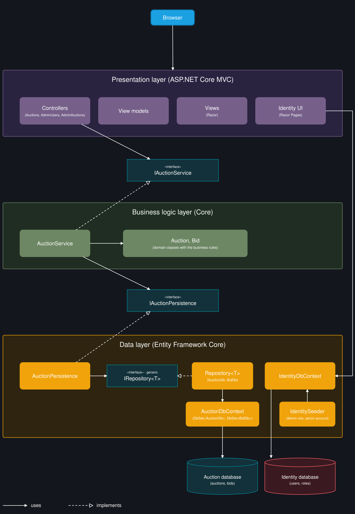
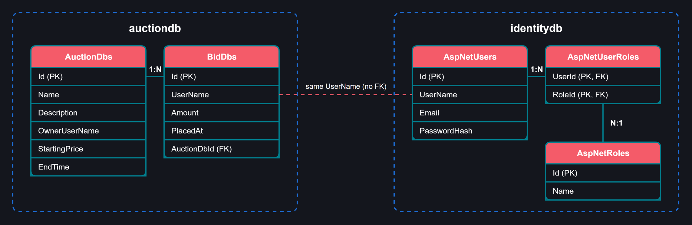

# Auction web app

A simplified auction system built with **ASP.NET Core 8 MVC**, **Entity Framework Core** and **ASP.NET Core Identity**, following a **three-tier architecture** with interfaces and dependency injection between the layers.

Lab 2 in the course *HI1031 Distributed Information Systems* at KTH Royal Institute of Technology.

## Features

### Grade 3
- Register, log in and log out
- Create an auction
- Edit the description of your own auction
- List all active auctions, sorted by end date
- View details of an active auction, with bids sorted highest first
- Place a bid on someone else's active auction (must be higher than the current price)
- List active auctions you have bid on
- List ended auctions you have won
  
### Grade 4
- Generic repository in the data layer

## Demo

https://github.com/user-attachments/assets/628e2dad-8dad-42b7-b5c3-afd92416ad8d

## Architecture

Each layer only calls the layer directly below it, through an interface.

<p align="center">
  
</p>

## Project structure

```
Auction-webapp/
├── docs/                       Architecture and database diagrams, database setup script
├── AuctionApp/
│   ├── Areas/Identity/Pages/   Layout shim so the Identity UI pages use the app layout
│   ├── Controllers/            AuctionsController, HomeController
│   ├── Core/                   Auction, Bid, AuctionException, AuctionService
│   │   └── Interfaces/         IAuctionService, IAuctionPersistence
│   ├── Data/                   AuctionDb, BidDb, AuctionDbContext, AuctionPersistence, ...
│   │   ├── Migrations/Identity EF Core migrations for the Identity database
│   │   └── Repositories/       IRepository, Repository (generic repository over EF Core)
│   ├── Migrations/             EF Core migrations for the auction database
│   ├── Models/Auctions/        View models: AuctionVm, AuctionDetailsVm, CreateAuctionVm, ...
│   ├── Views/                  Auctions (Index, Details, Create, Edit, MyBids, Won), Home, Shared
│   ├── wwwroot/css/site.css    Styling
│   ├── appsettings.json        Connection strings for the two databases (password in user secrets)
│   └── Program.cs              Dependency injection and request pipeline
└── AuctionApp.sln
```

## Database



Two separate MySQL databases:

- **Auction database** (`auctiondb`): auctions and bids, where each bid has a foreign key to its auction
- **Identity database** (`identitydb`): users and roles, managed by ASP.NET Core Identity

## Contributors

- Ibrahim Awad, iawad@kth.se
- Wajeed Abid, wajeeda@kth.se  

## License

This Lab is licensed under the MIT License. See LICENSE for details.

## Course

HI1031 Distributed Information Systems, KTH Royal Institute of Technology, 2026.
