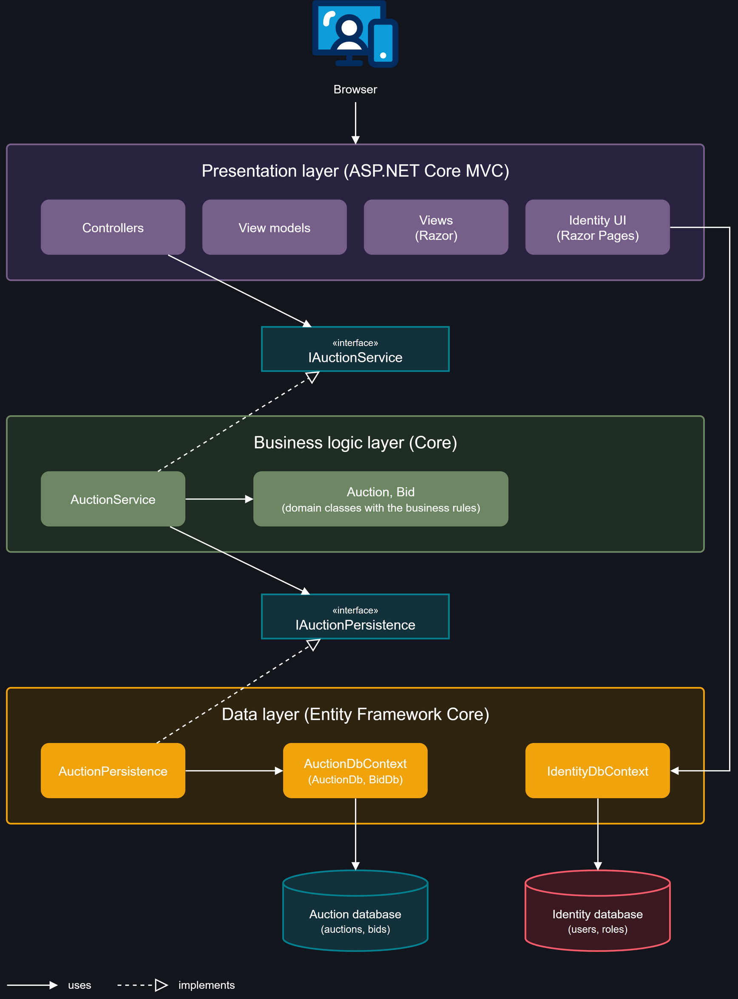

# Auction Web App

A simplified auction system where registered users can create auctions and place bids on other users' auctions.

Lab 2 in HI1031 Distributed Information Systems at KTH.

## Tech stack

- ASP.NET Core 8 MVC
- Entity Framework Core
- ASP.NET Core Identity
- MySQL

## Architecture

Three-layer architecture with dependency injection between the layers:

- **Presentation:** controllers, views and view models
- **Business logic:** domain classes and services
- **Persistence:** Entity Framework classes and database access

## Contributors

- Ibrahim Awad
- Wajeed Abid

## License

This lab is licensed under the MIT License. See LICENSE for details.

## Course

HI1031 Distributed Information Systems, KTH Royal Institute of Technology, 2026.
